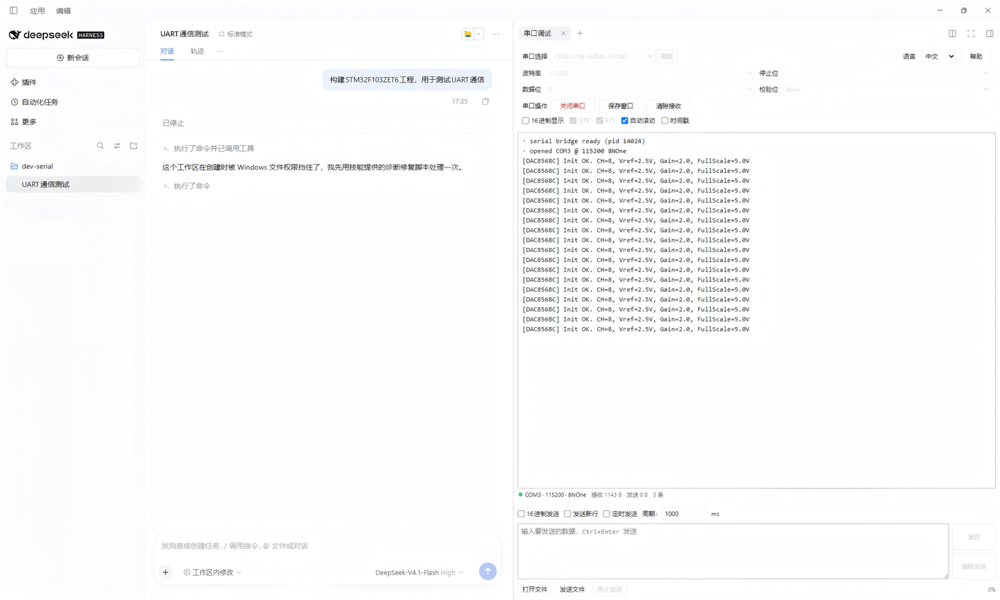

# dsh-serial-proto

A serial-port debugger with protocol decoding for DeepSeek Harness. Pick a JSON protocol model and the panel splits incoming bytes into frames, verifies the checksum, and decodes command, payload and status — and it can compose frames to send.

A fork of [`floydc-sz/dsh-serial-debugger`](https://github.com/floydc-sz/dsh-serial-debugger) 1.1.5 (MIT). The serial UI and transport are the original author's; the protocol layer is new.



## Differences from the original

| | dsh-serial-debugger | dsh-serial-proto |
| --- | --- | --- |
| Port settings / text / hex send & receive | ✅ | ✅ (same UI and interactions) |
| Frame splitting and checksum | ❌ raw bytes only | ✅ per protocol model |
| Command / status decoding | ❌ | ✅ command name, payload hex, error name |
| Frame composing | ❌ | ✅ pick a command, enter payload, optional status frame |
| Per-project switching | — | ✅ one `.dsh/protocols/*.json` per project |

Protocol models are generated by `dsh-proto`'s `proto_scan` from firmware source, or written by hand. A model lives at `.dsh/protocols/<name>.json` inside the project, so switching projects only means switching files.

## Features

- Right-sidebar "Serial debugger" tab: port parameters, live receive (text/hex), send, timestamps, auto-scroll, timed send, file send/save.
- **Protocol row**: choose a project directory (defaults to the current workspace), pick a model (or "Raw data" to disable decoding), and see a `baud · checksum · N commands` summary.
- Receive area switches to a **frame view** when a protocol is active: direction, command name + code, payload hex/ASCII, status code + error name.
- Send area gains a **compose** row when a protocol is active: command dropdown, payload hex, a `status frame` checkbox (builds a response frame whose payload is a single status byte), and a send button.
- Logs and decoded frames are pulled incrementally by cursor; a page refresh starts a new log.
- Remembers the last protocol model in `~/.dsh/serial-proto.json`.

## Install

Requires DSH ≥ 0.2.0-rc.1 (tested on the 0.2.2-rc.3 desktop app) and Node ≥ 20.

From GitHub:

```sh
dsh plugin --profile desktop add github:mustarddaddy/dsh-serial-proto
```

From npm (once published):

```sh
dsh plugin --profile desktop add dsh-serial-proto
```

Or install the directory as a bundle:

```sh
dsh plugin install <path-to-dsh-serial-proto>
```

Refresh the page afterwards; the "Serial debugger" tab appears in the right sidebar.

This plugin and `dsh-serial-debugger` use different bundle ids and tab keys — **do not install both** (they compete for the same port and show two tabs). To switch back:

```sh
dsh plugin remove dsh-serial-proto
dsh plugin add dsh-serial-debugger
```

## Quick start

1. Generate a protocol model from a firmware project (requires the `dsh-proto` plugin):
   ```
   proto_scan { "projectDir": "C:\\your-project" }
   ```
   Or write `.dsh/protocols/<name>.json` by hand (format below).
2. Open the right-sidebar panel, pick the project directory in the **Protocol** row and select the model.
3. Choose a port, open it, and incoming frames are shown with command names and payloads.
4. In the **compose** row, pick a command, enter payload hex and send; ticking `status frame` builds a response frame with a single status byte (useful as simulated replies during bring-up).

## Protocol model

```json
{
  "schema": 1,
  "name": "hotstamp",
  "transport": { "baudRate": 115200, "dataBits": 8, "parity": "None", "stopBits": "One" },
  "framing": {
    "sync": [],
    "end": null,
    "fields": [
      { "name": "command", "type": "u8" },
      { "name": "datalength", "type": "u8" }
    ],
    "lengthField": "datalength",
    "lengthIncludes": "payload",
    "checksum": {
      "algorithm": "crc16-modbus",
      "init": 65535,
      "coverage": "frame",
      "byteOrder": "be",
      "acceptEitherOrder": true
    },
    "maxPayload": 768,
    "statusWhenPayloadLength": 1,
    "payloadAsStatus": true,
    "overrides": [
      {
        "when": { "command": 100 },
        "fields": [
          { "name": "command", "type": "u8" },
          { "name": "datalength", "type": "u16", "endian": "be" }
        ]
      }
    ]
  },
  "commands": [{ "code": 10, "name": "CMD_GET_ID", "label": "Get ID" }],
  "errors": [{ "code": 0, "name": "CMD_SUCCESS", "label": "Success" }]
}
```

Key fields:

- `framing.fields` — header fields; the first one must be the command byte; the length field width decides the wire size (u8 = 1 byte, u16 = 2 bytes).
- `lengthIncludes` — whether the length field counts payload only (`payload`) or the whole frame (`frame`).
- `checksum.coverage` — `frame` (includes sync), `header+payload` (excludes sync), `payload` (payload only).
- `overrides` — per-command exceptions, e.g. an IAP download command with a u16 length field.
- `statusWhenPayloadLength` + `payloadAsStatus` — a payload of that length decodes as a status code.

## HTTP API

Prefix `/dsh-serial-proto` (localhost, used by the panel itself):

| Method & path | Description |
| --- | --- |
| `GET /state?since=&frameSince=` | Log delta, frame delta, bridge status, current protocol |
| `GET /ports` | Enumerate serial ports |
| `POST /open` | `{port,baudRate,dataBits,parity,stopBits}` |
| `POST /close` | Close the port |
| `POST /send` | `{base64,label}` raw send |
| `POST /protocol` | `{dir,name}` select a model; empty `dir` clears it |
| `GET /protocols?dir=` | List `.dsh/protocols/*.json` with command tables |
| `POST /sendframe` | `{command,payloadHex,status}` compose and send a frame |
| `POST /clear` | Clear log and frames |
| `POST /report` | Client reports tab registration state |

## Permissions and limitations

- **Files**: reads `.dsh/protocols/*.json` in the project; writes `~/.dsh/serial-proto.json` (last-used model).
- **Processes**: spawns PowerShell (`lib/serial-helper.ps1`) on Windows or Node (`lib/serial-helper.mjs`) on POSIX to drive the port.
- **Network**: HTTP routes bound to localhost only.
- Any other serial plugin competing for the same COM port must be closed first.

## Development

- Protocol engine in `lib/protocol/`: `model.js` (validate/load), `frame.js` (parse/build/checksum), `crc.js` (checksum algorithms) — copied from `dsh-proto`.
- After changing host code, remove and reinstall the bundle (host modules are not hot-reloaded).
- Smoke test: `node test/smoke.mjs` (model load + compose + parse + sample decode).

## License and attribution

MIT. Original UI and serial bridge from [dsh-serial-debugger](https://github.com/floydc-sz/dsh-serial-debugger) © 2026 floydc-sz; protocol model and decoding layer added by this fork. Upstream copyright notice retained in [LICENSE](LICENSE).
