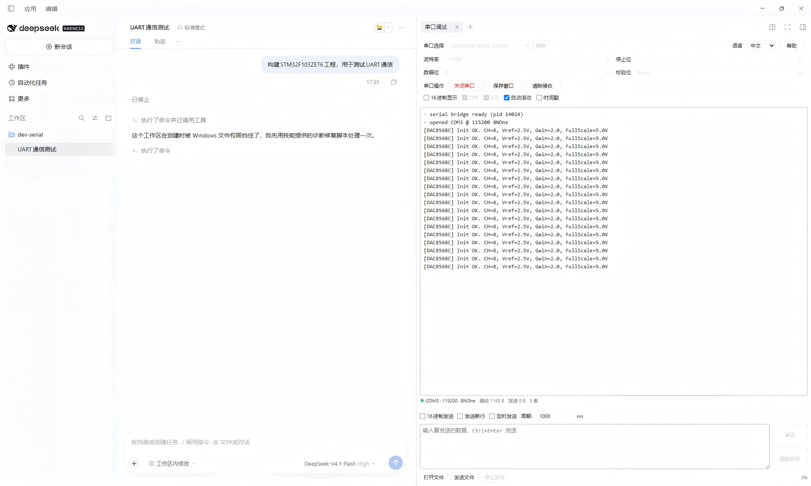

# dsh-serial-proto

DeepSeek Harness 的**串口调试 + 协议解码**右侧栏面板：选一个 JSON 协议模型，收到的字节流就会自动切帧、校验和解码；发送时也可以按模型组帧。

Fork 自 [`floydc-sz/dsh-serial-debugger`](https://github.com/floydc-sz/dsh-serial-debugger) 1.1.5（MIT），保留原有串口收发界面，新增协议模型层。



## 与原版的区别

| | dsh-serial-debugger | dsh-serial-proto |
| --- | --- | --- |
| 串口参数 / 文本 / 十六进制收发 | ✅ | ✅（UI 与交互保持一致） |
| 帧切分与校验（CRC16 等） | ❌ 只显示原始字节 | ✅ 按协议模型切帧、验校验和 |
| 命令 / 状态码解码 | ❌ | ✅ 显示命令名、负载 hex、错误名 |
| 按模型组帧发送 | ❌ | ✅ 选命令、填负载、可选状态帧 |
| 多项目切换 | — | ✅ 每个工程一份 `.dsh/protocols/*.json` |

协议模型由 `dsh-proto` 的 `proto_scan` 扫描固件源码生成，也可以手写；模型放在工程根的 `.dsh/protocols/<name>.json`，随工程走。

## 功能

- 右侧栏「串口调试」页签：串口参数、实时接收（文本/十六进制）、发送、时间戳、自动滚动、定时发送、文件收发。
- **协议行**：选择工程目录（默认当前工作区），下拉选协议模型（或「原始数据」关闭解码），显示 `波特率 · 校验 · 命令数` 摘要。
- 接收区在协议激活时切换为**帧视图**：方向（收/发）、命令名 + 命令码、负载 hex/ASCII、状态码 + 错误名。
- 发送区在协议激活时多出**组帧**行：命令下拉、负载 hex、`状态帧` 复选（勾选时按应答帧构造，即负载为一个状态字节）、发送按钮。
- 日志与解码帧都按游标增量拉取；刷新页面后日志重新开始。
- 记住上次使用的协议模型（`~/.dsh/serial-proto.json`），下次打开面板自动恢复。

## 安装

要求 DSH ≥ 0.2.0-rc.1（在 0.2.2-rc.3 桌面端验证），Node ≥ 20。

从 GitHub 安装：

```sh
dsh plugin --profile desktop add github:mustarddaddy/dsh-serial-proto
```

从 npm 安装（发布后可用）：

```sh
dsh plugin --profile desktop add dsh-serial-proto
```

也可以直接把本目录当 bundle 安装：

```sh
dsh plugin install <解压后的 dsh-serial-proto 目录>
```

安装后刷新页面，右侧栏出现「串口调试」页签。

本插件与 `dsh-serial-debugger` 使用不同的 bundle id 和页签 key，**不要同时安装**（会争同一串口并出现两个页签）。从原版切回：

```sh
dsh plugin remove dsh-serial-proto
dsh plugin add dsh-serial-debugger
```

## 快速开始

1. 在固件工程里生成协议模型（需要 `dsh-proto` 插件）：
   ```
   proto_scan { "projectDir": "F:\\your-project" }
   ```
   或在工程里手写 `.dsh/protocols/<name>.json`（格式见下）。
2. 打开右侧栏「串口调试」，在**协议**行选择工程目录并选中模型。
3. 选串口 → 打开端口，收到的帧会以命令名和负载展示。
4. 在**组帧**行选命令、填负载 hex、点发送；勾「状态帧」会构造一个只有状态字节的应答帧（用于联调时的模拟回复）。

## 协议模型

```json
{
  "schema": 1,
  "name": "hotstamp",
  "transport": { "baudRate": 115200, "dataBits": 8, "parity": "None", "stopBits": "One" },
  "framing": {
    "sync": [],
    "end": null,
    "fields": [
      { "name": "command", "type": "u8" },
      { "name": "datalength", "type": "u8" }
    ],
    "lengthField": "datalength",
    "lengthIncludes": "payload",
    "checksum": {
      "algorithm": "crc16-modbus",
      "init": 65535,
      "coverage": "frame",
      "byteOrder": "be",
      "acceptEitherOrder": true
    },
    "maxPayload": 768,
    "statusWhenPayloadLength": 1,
    "payloadAsStatus": true,
    "overrides": [
      {
        "when": { "command": 100 },
        "fields": [
          { "name": "command", "type": "u8" },
          { "name": "datalength", "type": "u16", "endian": "be" }
        ]
      }
    ]
  },
  "commands": [{ "code": 10, "name": "CMD_GET_ID", "label": "查询ID" }],
  "errors": [{ "code": 0, "name": "CMD_SUCCESS", "label": "成功" }]
}
```

关键字段：

- `framing.fields`：帧头字段，第一个必须是命令字节；长度字段类型决定线宽（u8 = 1 字节，u16 = 2 字节）。
- `lengthIncludes`：长度字段写的是负载长（`payload`）还是整帧长（`frame`）。
- `checksum.coverage`：`frame`（含 sync）、`header+payload`（不含 sync）、`payload`（只算负载）。
- `overrides`：命令级例外，例如 IAP 下载命令把长度字段改成 u16。
- `statusWhenPayloadLength` + `payloadAsStatus`：负载长度等于该值时按状态码解码。

## HTTP 接口

前缀 `/dsh-serial-proto`（localhost，仅供本面板使用）：

| 方法与路径 | 说明 |
| --- | --- |
| `GET /state?since=&frameSince=` | 串口日志增量、解码帧增量、桥接状态、当前协议 |
| `GET /ports` | 枚举串口 |
| `POST /open` | `{port,baudRate,dataBits,parity,stopBits}` |
| `POST /close` | 关闭串口 |
| `POST /send` | `{base64,label}` 原始发送 |
| `POST /protocol` | `{dir,name}` 设置当前协议模型；`dir` 为空清除 |
| `GET /protocols?dir=` | 列出该目录 `.dsh/protocols/*.json` 及每个模型的命令表 |
| `POST /sendframe` | `{command,payloadHex,status}` 组帧并发送 |
| `POST /clear` | 清空日志与帧 |
| `POST /report` | 客户端上报页签注册状态 |

## 权限与限制

- **文件**：读取工程目录下的 `.dsh/protocols/*.json`；写入 `~/.dsh/serial-proto.json`（记住上次模型）。
- **进程**：Windows 用 PowerShell（`lib/serial-helper.ps1`）驱动串口，POSIX 用 Node（`lib/serial-helper.mjs`）。
- **网络**：只监听 localhost 的 HTTP 路由。
- 与 `dsh-serial-debugger`、`meng14774` 的串口类插件共用 COM 口时，同一时间只能打开一个。

## 开发

- 协议引擎在 `lib/protocol/`：`model.js` 校验/加载、`frame.js` 切帧/组帧/校验、`crc.js` 校验算法；从 `dsh-proto` 复制而来。
- 改 host 代码后需要在 DSH 里移除并重新安装本 bundle（host 模块不热重载）。
- 冒烟测试：`node test/smoke.mjs`（模型加载 + 组帧 + 切帧 + 样本解码）。

## 许可与致谢

MIT。原始界面与串口桥来自 [dsh-serial-debugger](https://github.com/floydc-sz/dsh-serial-debugger)（© 2026 floydc-sz），协议模型与解码层为本 fork 新增。保留上游版权声明，详见 [LICENSE](LICENSE)。
